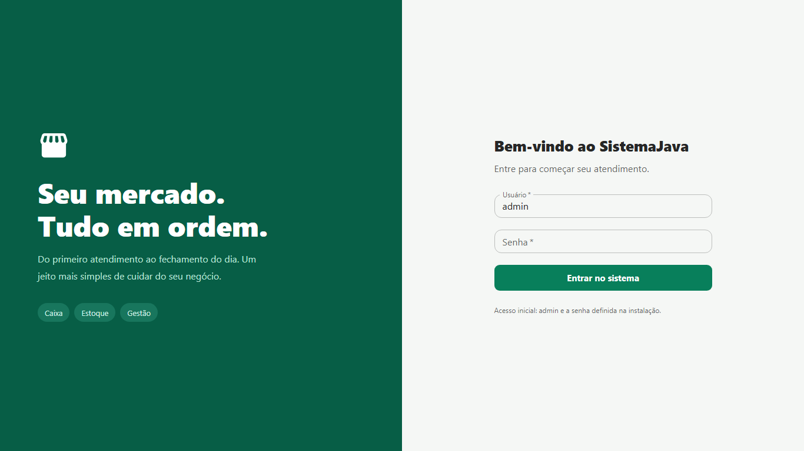
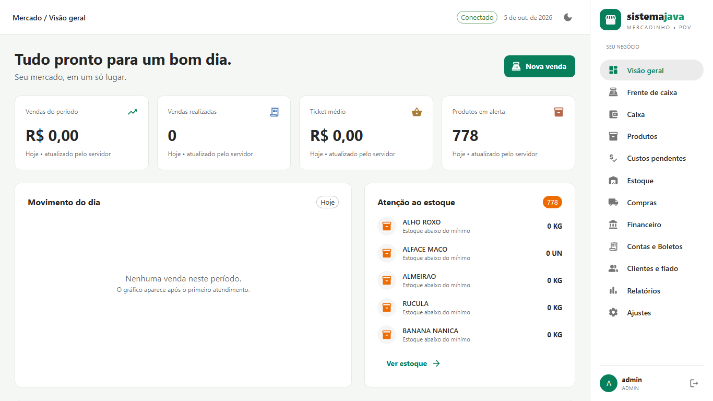
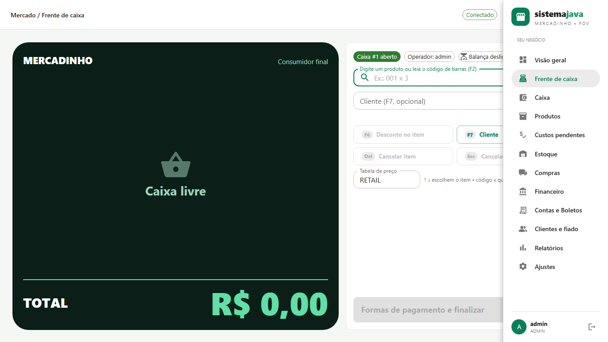
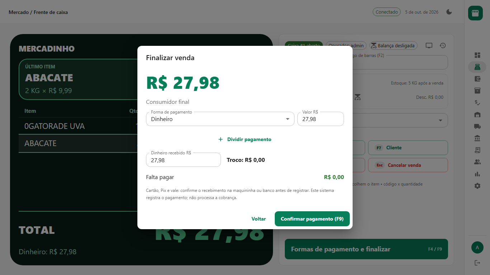
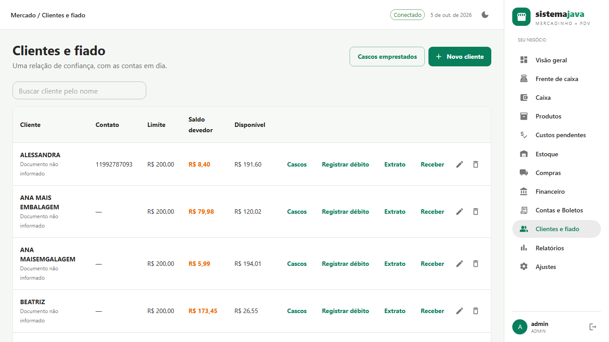
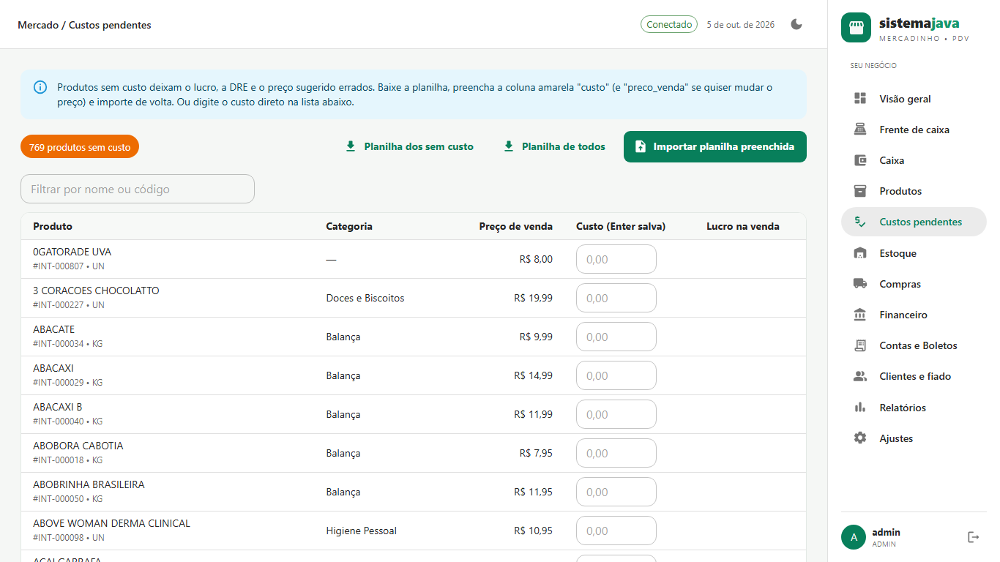
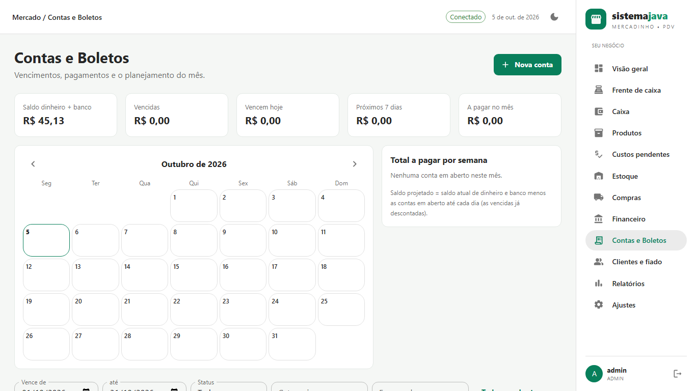
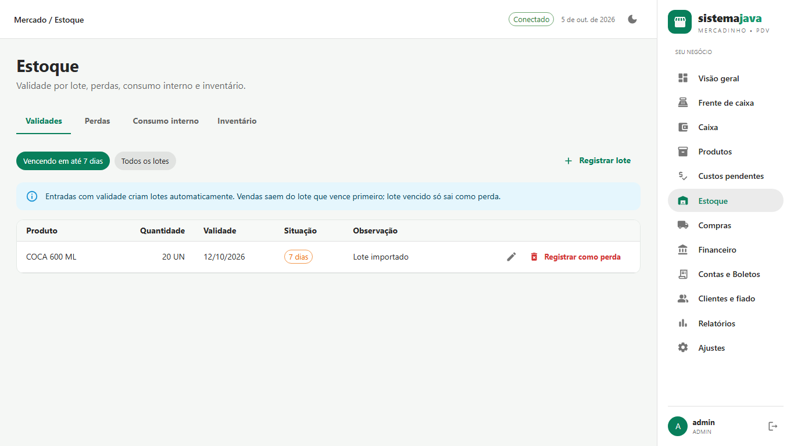
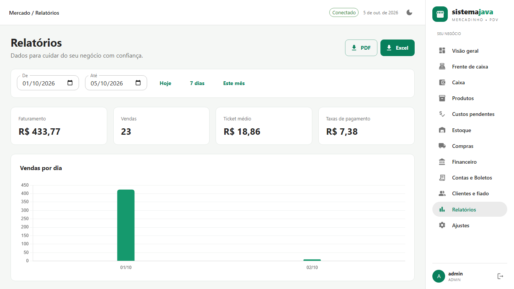
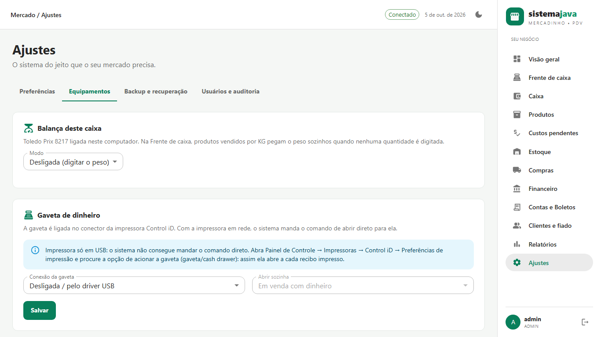

# Empório POS — Point of Sale and Store Management for Small Markets

A complete POS and back office for small markets, grocery stores and corner shops. Sales,
stock, customer credit ("fiado"), purchasing, finance and reports in a single local
application, with a modern responsive interface.



| | |
|:--|:--|
| **Live demo** | Desktop app — no hosted demo |
| **Screenshots** | [portfolio](portfolio) |
| **Stack** | Java · Spring Boot · React · TypeScript · PostgreSQL |
| **License** | MIT — [LICENSE](LICENSE) |

> The application interface is in Brazilian Portuguese, because the operators and the
> fiscal language are Brazilian. This README is in English.

## Overview

- **Frontend:** React 18, TypeScript, Vite and Material UI
- **Backend:** Java 17, Spring Boot, Maven, Flyway and JWT
- **Database:** PostgreSQL 15
- **Infra:** Docker Compose, automatic backup with `pg_dump`
- **Hardware:** Toledo Prix 8217 scale (Web Serial) and Control iD 80 mm thermal printer

The interface is designed for checkout monitors (1366×768), with an adaptable side menu and
keyboard shortcuts for fast POS work.

## Screens

| Dashboard | Point of sale | Payment |
|---|---|---|
|  |  |  |

| Customers and credit | Missing costs | Bills to pay |
|---|---|---|
|  |  |  |

| Stock | Reports | Settings / drawer |
|---|---|---|
|  |  |  |

See every image in the [`portfolio/`](portfolio/) folder.

## Main features

- **Fast POS:** debounced search, barcode scanner as keyboard input, `code x N` quantity, cart,
  discounts and split payments.
- **Cash control:** opening float, cash-out, cash-in, closing with reconciliation and a
  printable report.
- **Catalogue and stock:** unique codes/barcodes, categories, UN/KG, costs, minimum stock,
  expiry per batch (FEFO), losses and internal consumption.
- **Costs:** dedicated screen for products without a cost, with bulk import from an
  Excel/CSV sheet and live margin calculation.
- **Customer credit:** limit, term, interest and late fee, printable statement, partial
  receipts and manual debits.
- **Purchasing and suppliers:** invoice with several products, average cost, batches and a
  price suggested by the category margin.
- **Finance:** bills to pay with a calendar, receivables, cards, transfers, management P&L and
  cash flow.
- **Reports:** sales by period, category, ABC curve, best customers, stock, expiry and
  PDF/Excel export.
- **Security:** JWT, BCrypt, CSRF, role-based control (ADMIN / MANAGER / CASHIER) and a
  persistent audit trail.
- **Real-time updates:** WebSocket/STOMP with visual stock and expiry alerts.

## Starting on Windows

Requirement: Docker Desktop running. On the first run the script downloads images and
dependencies.

```powershell
git clone https://github.com/FelipeFeerreira/retail-pos-java.git
cd retail-pos-java
.\iniciar.bat
```

Or manually:

```powershell
powershell -NoProfile -ExecutionPolicy Bypass -File scripts/setup.ps1
docker compose up --build -d
```

Open **http://localhost:3000**.
Default user: **admin**. The password is in the local `.env` file (never publish that file).

- Interface: http://localhost:3000
- Swagger: http://localhost:8080/swagger-ui.html
- OpenAPI JSON: http://localhost:8080/v3/api-docs
- Health: http://localhost:8080/actuator/health

Linux/macOS:

```sh
bash scripts/setup.sh
docker compose up --build -d
```

## First sale

1. Sign in as admin and check the sample products.
2. In **Cash**, enter the opening float and click **Open register**.
3. Open **Point of sale**, type the product code and press Enter.
4. Press **F9** to open payment.
5. Choose the payment method, enter the amount received and confirm.
6. Finish the sale and print the non-fiscal receipt.

## Local development

Requirements: JDK 17+, Maven 3.9+, Node 22 LTS and PostgreSQL 15.

```sh
cd backend
mvn spring-boot:run

# Another terminal:
cd frontend
npm ci
npm run dev
```

In local mode, `pg_dump`/`pg_restore` 15 must be on the PATH. Vite proxies `/api` and `/ws` to
`localhost:8080`.

## Tests

```sh
mvn -B -f backend/pom.xml verify

cd frontend
npm ci
npm test -- --coverage
npm run build
npm run e2e
```

The backend uses JUnit 5, MockMvc and Testcontainers against a real PostgreSQL. The frontend
uses Jest/Testing Library and Cypress with login → sale → receipt against the real API.

## Structure

```text
backend/      Spring Boot, Maven, entities, services, controllers, Flyway and tests
frontend/     React/Vite, MUI, Redux/RTK Query, Chart.js, Jest and Cypress
scripts/      credential setup and local utilities
docs/         architecture, contracts, validation and operation
portfolio/    screenshots for presentation and portfolio
docker-compose.yml
```

## Importing data from the Python system

If you have the previous Python/SQLite system, use:

```sh
node scripts/import-python.mjs "/path/to/mercadinho.db" --apply
```

## Notes

- It does not include fiscal receipt issuing, a homologated acquirer/Pix integration or e-mail
  sending.
- The scale and the drawer are configurable in Settings → Hardware.
- Data and brands in the screenshots are fictional and used for demonstration only.

---

Built by [Felipe Ferreira dos Reis](https://github.com/FelipeFeerreira).

---

## What I would do next

- Package a Windows installer with the backend and database embedded to cut setup friction.
- Expand the integration tests for the customer-credit rules and register closing.
- Isolate the Cypress scratch spec so the CI suite only runs the maintained scenarios.

## License

MIT - see [LICENSE](LICENSE). You may use, modify and redistribute this code with attribution.
